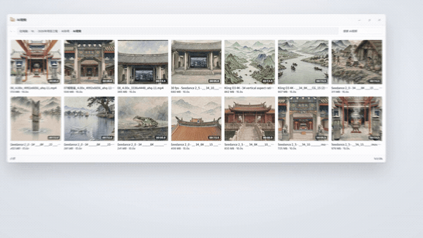
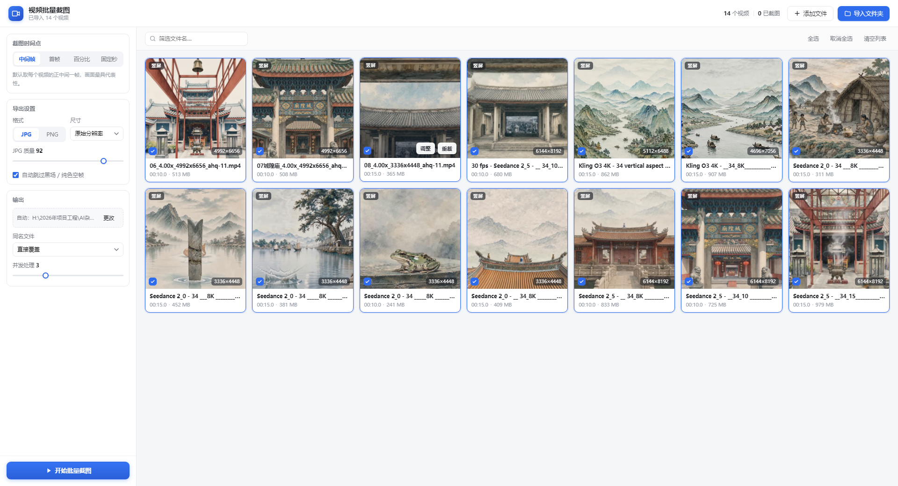
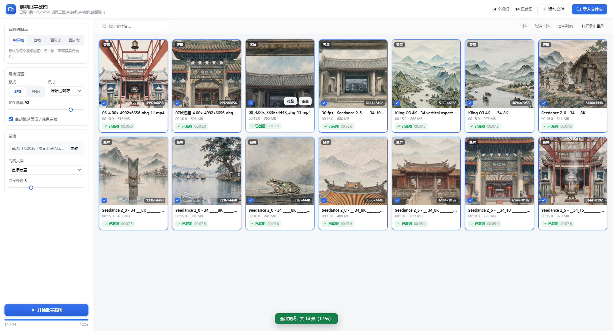
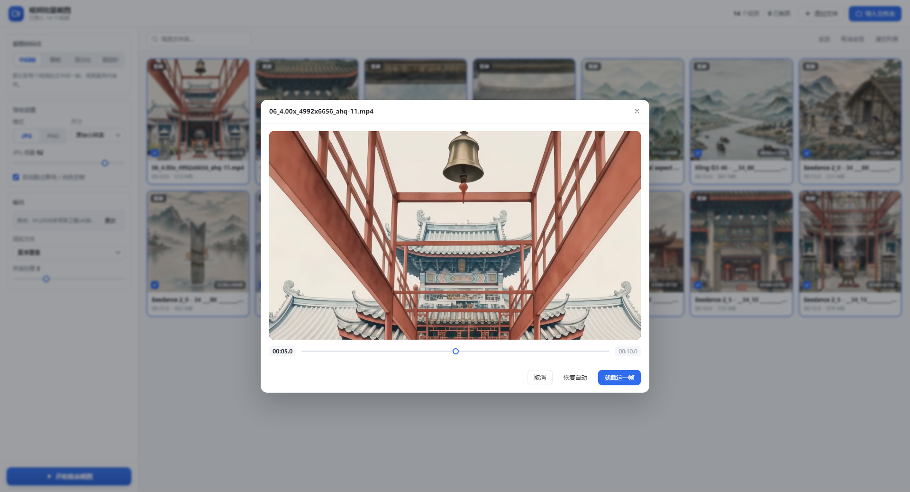

<p align="center">
  
</p>

<h1 align="center">视频批量截图工具</h1>

<p align="center">给一批视频各截一张图。本地解码，不上传，8K 竖屏原片直接取帧。</p>

<p align="center">
  <a href="../../releases/latest"></a>
  
  
  
</p>

---

做 AI 视频的人都有这一步：一批片子渲染完了，要各取一张当封面、当首图、当缩略图。  
用播放器一个个拖进度条截图，14 个片子要花半小时；用在线工具，几十 GB 的原片得先传上去。

这个工具只做一件事：**你选一批视频，它给每个视频出一张图**。全程在本机用 ffmpeg 按路径解码，文件不复制、不上传、不改动原片。

14 个 8K 竖屏视频（8.6 GB），并发 3，**12.5 秒全部出完**。

## 下载

到 [Releases](../../releases/latest) 下载 `视频批量截图工具_v1.1.0_安装包.exe`（约 119 MB）。

- 双击 → 向导 → 装到 `%LOCALAPPDATA%\Programs\视频批量截图工具`，**不需要管理员权限**
- 内置 Electron 运行时和 ffmpeg，目标机器不用另装任何东西
- 桌面 + 开始菜单快捷方式，可在「设置 → 应用」里卸载

同一个页面里还有 `promo-film-v1.1.0.mp4`——30 秒、1080p 的操作演示，上面那张动图就是它的片段。

## 界面

<p align="center">
  
</p>

左边是设置（时间点、格式、尺寸、输出目录、并发），右边是这批视频的卡片。每张卡上标着分辨率、时长、体积——都是 ffprobe 从文件里真实读出来的。

<p align="center">
  
  
</p>

## 怎么用

1. **导入** — 把一批视频或整个文件夹**直接拖进窗口**（推荐）；或「导入文件夹」递归扫描；或「添加文件」多选；也可以粘路径回车。重复导入自动去重。
2. **选时间点** — 中间帧（默认）/ 首帧 / 百分比 / 固定秒。某张不合适就点「调整」，拖滑块看大图定帧。
3. **设导出** — JPG（质量可调）或 PNG；尺寸可选原始分辨率或长边 4096 / 2048 / 1080。
4. **开始批量截图** — 默认导出到「视频所在文件夹\截图导出」，可改成任意目录。

## 特性

- **拖拽直接可用** — 桌面版通过 Electron 的 `webUtils.getPathForFile()` 拿到文件真实路径，拖进来就按路径解码，不经过上传，也不复制一份到临时目录。
- **本地解码，不联网** — 视频不进浏览器、不出本机。8K 竖屏原片直接从磁盘取帧，走的是 ffmpeg 的解码器，不是浏览器的 `<video>`。
- **自动跳过黑场** — 取到的中间帧偏黑时，自动换时间点重试，避免导出一张纯黑图。
- **同名覆盖** — 重跑不会堆出一堆 `(2)(3)` 副本；也可以切成「自动加序号另存」保留历史版本。
- **单张补救** — 批量跑完后某张不满意，单独重截或调时间点重出，不影响其他。
- **并发可调** — 左侧滑块 1–6，机械盘往下调，SSD 可以调高。

## 支持格式

mp4 / mov / mkv / avi / wmv / flv / webm / m4v / mpg / mpeg / ts / m2ts / mts / 3gp / rmvb / rm / asf / ogv / f4v / vob / mxf —— 取决于 ffmpeg 的解码器，常见格式基本都覆盖。

## 性能参考

本机测试：14 个 8K 竖屏视频（4992×6656 到 6144×8192，合计 8.6 GB），并发 3，全量出图 **12.5 秒**，平均每张不到 1 秒。瓶颈在磁盘随机读，不在解码。

## 从源码跑

开发调试（需要 Node.js ≥ 18，且系统里有 ffmpeg）：

```bash
node server.js          # 起本地服务，自动打开浏览器
```

或者双击 `启动截图工具.bat`。**浏览器模式不支持拖拽导入**——浏览器出于安全不给 File 对象的本地路径，工具又是「ffmpeg 按路径读盘」的设计，所以只能在页面里用「导入文件夹」。日常使用请装桌面版。

跑桌面壳：

```bash
cd desktop
npm install
npm start
```

打包成安装包：

```bash
npx electron-packager . "视频批量截图工具" --platform=win32 --arch=x64 --out=../build/_test --overwrite
```

然后用 NSIS 跑 `build/installer.nsi`。完整流程写在 [`build/打包说明.md`](build/打包说明.md)——包括怎么只带 Electron 自带的 Node 起服务（省 95 MB）、端口自动顺延、单实例锁这些细节。

## 目录

| 路径 | 作用 |
| --- | --- |
| `server.js` | 本地服务：扫描、调 ffmpeg 取帧、导出 |
| `app/` | 界面（窗口内加载的网页），请勿单独移动 |
| `desktop/` | Electron 桌面壳：`main.js` 起服务并开窗，`preload.js` 只暴露取路径一个能力 |
| `build/` | 打包用的图标、向导图、NSIS 脚本 |
| `docs/` | README 用的截图与动图 |
| `promo-film/` | 30 秒宣传片的工程源码（HTML + GSAP + 内置乐谱），可用 [huashu-motion](https://www.npmjs.com/package/huashu-motion) 重新渲染 |
| `dist/` | 打包产物（不入库，走 Releases） |

## 常见问题

**拖进去没反应**  
装桌面版。浏览器模式拿不到本地路径，会提示改用「导入文件夹」。

**提示没有找到 ffmpeg**  
安装版自带 `resources\app\bin\ffmpeg.exe`，正常不会出现。源码版把 ffmpeg 的 `bin` 加进 PATH，或设环境变量 `FFMPEG_PATH` 指向 `ffmpeg.exe`。

**端口被占用**  
服务从 7788 起自动找空位（7789、7790…），窗口会自己连上，不用管。程序是单实例的，已在运行时再双击只会激活已有窗口。

**截图边缘有黑边**  
原片带的黑边会保留。可以先把尺寸缩到长边 2048 再裁，或在本工具之外处理。

**为什么不做成网页版给别人用**  
核心是「按路径读本地文件 + 不上传」。浏览器做不到这一点，硬要做就得先把几十 GB 读进内存再传给服务，等于把最想省的那一步又加回来了。

## License

[MIT](LICENSE)
